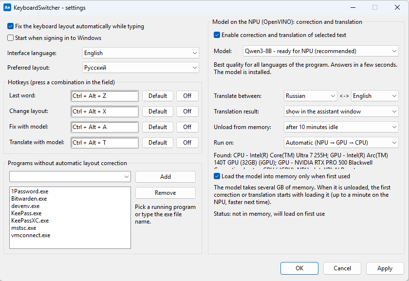
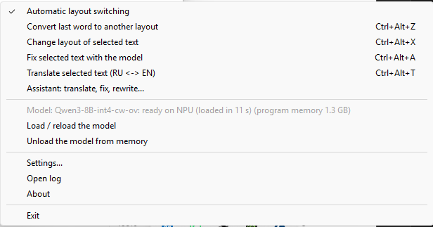
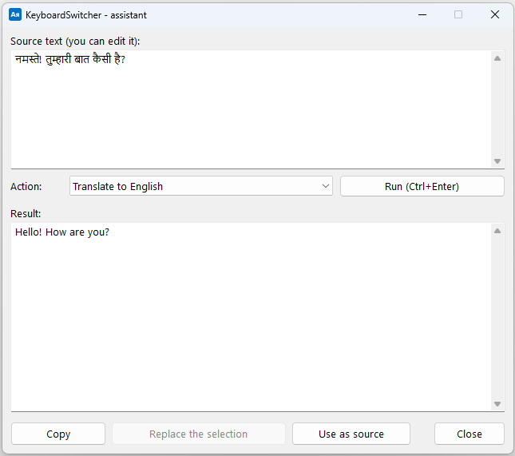

# switchkey-ai

**KeyboardSwitcher** is a Windows tray app that fixes text typed in the wrong keyboard layout and, optionally,
corrects, translates and rewrites selected text with a small language model running **locally** on the NPU, GPU or CPU
(Intel OpenVINO, AMD Ryzen AI, llama.cpp). Typed text is never stored or sent anywhere.

## Features

| What | How | Needs a model? |
|---|---|---|
| Auto-fix of the keyboard layout: English, Russian, Ukrainian, Hindi InScript (`ghbdtn` → `привет`, `ghbdsn` → `привіт`, `руддщ` → `hello`, `сьв` → `cmd`, `vcmdls` → `नमस्ते`) | automatic, after Space / Enter / Tab | no |
| Convert the last word / undo an auto-fix | **Ctrl+Alt+Z** | no |
| Convert the selected text to another layout | **Ctrl+Alt+X** | no |
| Correct the selected text (typos, wrong layout, capitalization, punctuation) | **Ctrl+Alt+A** | yes |
| Translate the selected text between two languages from settings (Russian ↔ English by default) | **Ctrl+Alt+T** | yes |
| Assistant: translate to English, Russian, Ukrainian, Slovak, Spanish or Hindi; fix, more polite, formal / casual, shorten, simplify, explain, reply | tray menu or Ctrl+Alt+T (window) | yes |

| Tray menu | Assistant window |
|---|---|
|  |  |

- **Interface languages:** English, Russian, Ukrainian, Slovak, Spanish, Hindi (the Windows language by default).
- **Preferred layout:** when a word looks the same in several layouts (`vfvf` = «мама» in both Russian and Ukrainian),
  the app switches to the preferred one — unless the previous word was in the other language.
- **Technical words** (cmd, git, npm, exe, ssh and ~380 more) are recognized even though they are missing from everyday
  dictionaries. The list is in `src/KeyboardSwitcher/Resources/tech.txt` (one word per line; rebuild after editing).
- Only the layouts installed in Windows are used.

## Running the model on NPU → GPU → CPU

Turn on **text correction by the model** in *Settings*. The app shows what it will download and how much, then installs
everything into `%LOCALAPPDATA%\KeyboardSwitcher`. The model is loaded on first use and unloaded after 10 idle minutes
(both configurable). *Run on* selects the device: **Automatic** (NPU → GPU → CPU) or a specific one; if it fails, the next
one in the order is used. The settings window lists the devices found on this computer.

| Processor | NPU | GPU | CPU |
|---|---|---|---|
| **Intel** | OpenVINO GenAI 2026.4.1 | OpenVINO, `GPU.0` (Intel graphics) | OpenVINO |
| **AMD** | [ryzenai-server](https://github.com/lemonade-sdk/ryzenai-server) (Ryzen AI, newest release ≥ 1.7.0) | llama.cpp b11936, Vulkan (Radeon or any Vulkan GPU) | llama.cpp |

Models (pick one in settings):

| Model | Intel (OpenVINO, INT4) | AMD GPU/CPU (GGUF) | AMD NPU (ONNX) |
|---|---|---|---|
| Qwen3-8B (default) | 4.75 GB | Q4_K_M, 5.0 GB | Qwen2.5-7B, 8.2 GB |
| Mistral-7B-Instruct-v0.3 | 3.8 GB | Q4_K_M, 4.4 GB | 7.5 GB |
| Phi-3.5-mini-instruct | 2.0 GB | Q4_K_M, 2.4 GB | 4.1 GB |
| Qwen3-4B | converted locally (~2.5 GB) | Q4_K_M, 2.5 GB | Qwen2.5-3B, 3.8 GB |
| Qwen3-1.7B | converted locally (~1.2 GB) | Q8_0, 1.8 GB | Qwen2.5-1.5B, 2.1 GB |

- Intel models that are not published for NPU are converted on this computer: the app installs Python 3.12 (per user)
  and Intel's conversion tools (~3 GB).
- If the Visual C++ Runtime is too old, the app installs it (Windows asks for confirmation).
- AMD NPU: only XDNA 2 (Ryzen AI 300/400) with NPU driver 32.0.203.280 or newer. XDNA 1 (Ryzen 7040/8040/200) can't run
  language models and is skipped. If the NPU comes first, llama.cpp with a GGUF model is installed too, so the GPU/CPU
  can take over when the NPU fails.
- On AMD the model runs in a separate process (llama-server / ryzenai-server) bound to 127.0.0.1; it is closed together
  with the app.

Example speed (Qwen3-8B, Intel Core Ultra 7 255H): NPU 9.5 tokens/s, first token ~4 s; Arc 140T GPU 17 tokens/s, ~0.1 s;
CPU 13 tokens/s, ~0.6 s.

## Files

- Settings: `%APPDATA%\KeyboardSwitcher\settings.json`
- Log (no typed text, no keystrokes): `%LOCALAPPDATA%\KeyboardSwitcher\log.txt`
- Engines and models: `%LOCALAPPDATA%\KeyboardSwitcher`

## Building

- Visual Studio 2022 / Rider: open `KeyboardSwitcher.sln`.
- Or install the .NET 10 SDK (`winget install Microsoft.DotNet.SDK.10`) and run `build.bat` → `dist\KeyboardSwitcher`
  (single self-contained exe; users don't need .NET). `build_zip.bat` also creates `dist\KeyboardSwitcher.zip`.
- `run.bat` starts the built app; `test_detector.bat` runs the layout detection tests (they also run on Linux).
- `tools\KeyProbe` shows what the keyboard sends (useful for Apple keyboards); `tools\LangTest` checks how well the
  model translates between languages.

## Limitations

- Layouts: English (US), Russian (ЙЦУКЕН), Ukrainian, Hindi InScript (Windows "Hindi Traditional"). The Ukrainian ґ
  (AltGr+г) and Hindi compound signs on the digit row (क्ष, त्र, ज्ञ) are not handled.
- Hindi: InScript only (checked at startup). Phonetic input (Hindi Phonetic, Google Input Tools) and Hindi written in
  Latin letters are left alone. The Hindi dictionary is small (~20k words), so short words that coincide with English
  ones (`Eh` = `आप`) are fixed only after a Hindi word.
- Doesn't work in windows of apps running as administrator (a Windows limitation).
- An unsigned app with a keyboard hook may trigger an antivirus or SmartScreen warning.
- Model correction: up to 1500 characters at a time; the first NPU load takes ~30 s, later loads are faster (cache).
- The AMD path has not been tested on real AMD hardware yet.

## Project structure

`src/KeyboardSwitcher` — C#, .NET 10, plain Windows API (no WinForms):

| File | Purpose |
|---|---|
| `KeyboardMonitor.cs` | keyboard hook, word tracking, replacement |
| `LayoutDetector.cs`, `Layouts.cs` | layout detection: frequency dictionaries + trigram model, key tables |
| `TrayApp.cs`, `SettingsWindow.cs`, `AssistantWindow.cs` | tray icon, menu, hotkeys, windows |
| `AiCorrector.cs` | prompts for correction, translation and rewriting |
| `AiPlatform.cs` | engine choice by processor vendor, NPU → GPU → CPU order |
| `OpenVinoGenAI.cs`, `LlmBackend.cs`, `AmdSupport.cs` | OpenVINO C API, local server backend, AMD detection and engines |
| `AiSetup.cs` | downloads and installation |
| `Loc.cs`, `Resources/Strings.tsv` | interface translations |

`tests/DetectorTests` — layout detection tests on dictionary words.

## License

[MIT](LICENSE). Third-party components and their licenses: [THIRD_PARTY_NOTICES.md](THIRD_PARTY_NOTICES.md).
